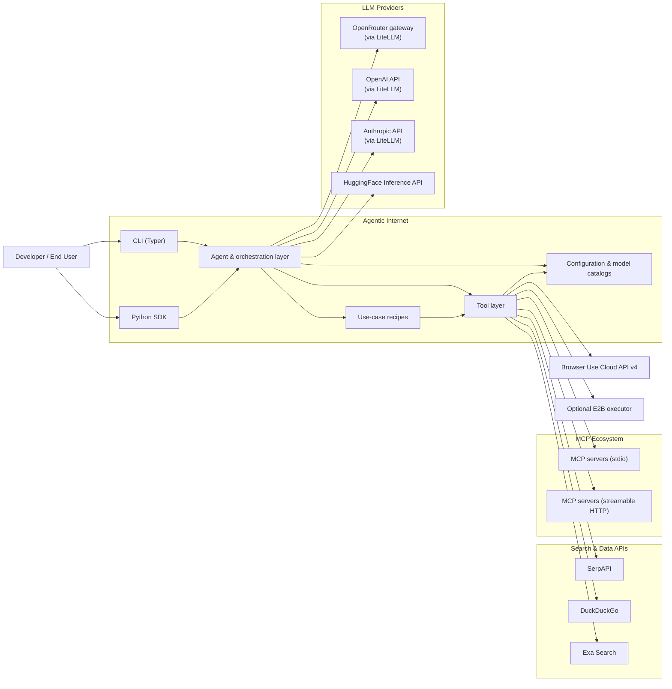
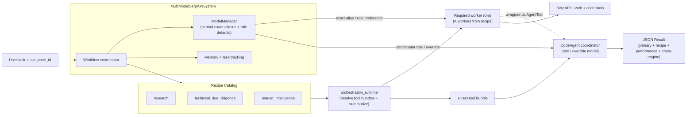
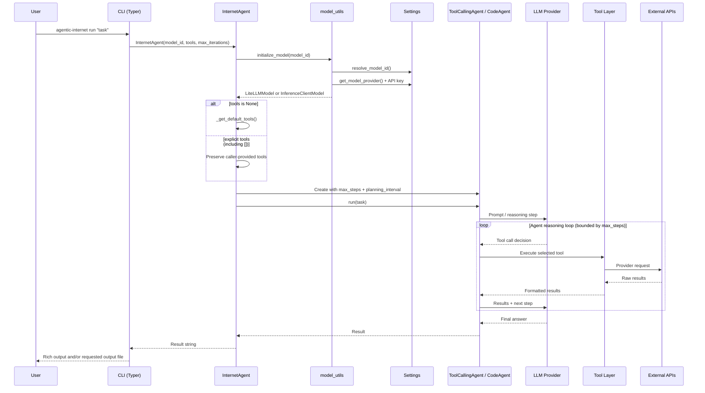
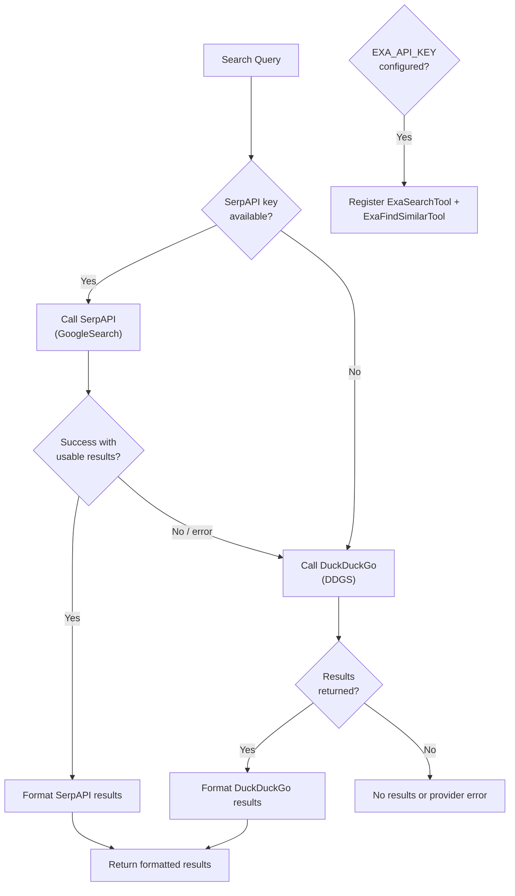
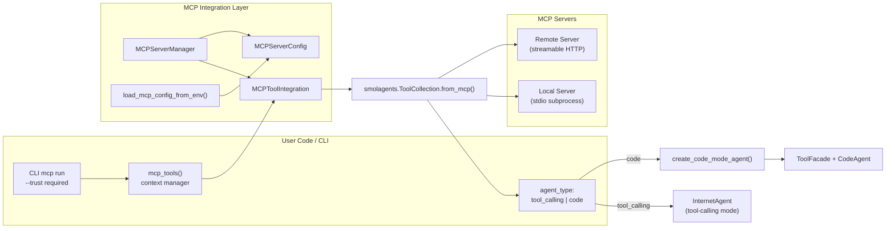
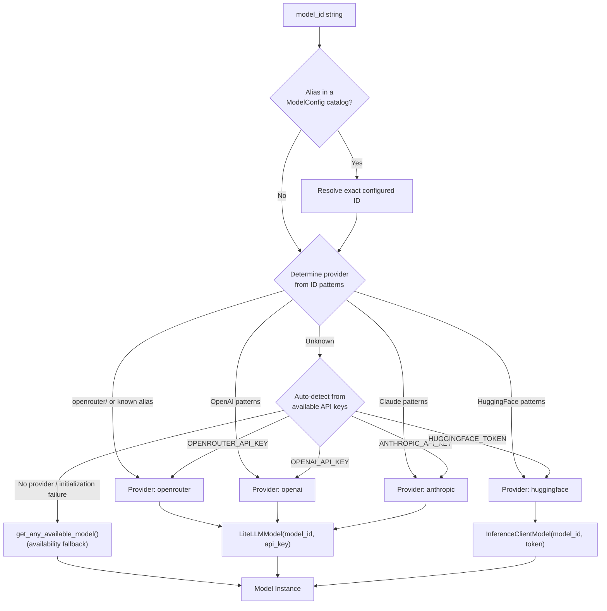
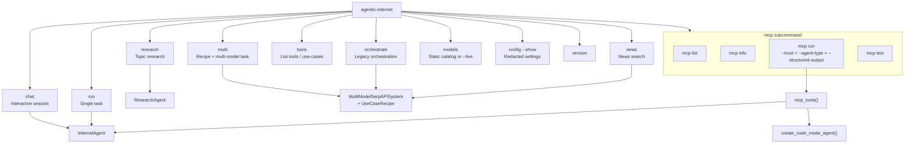
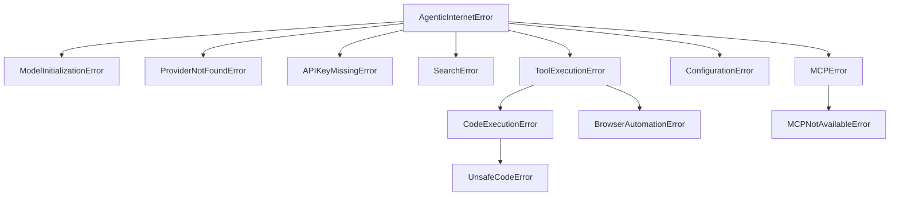

# Agentic Internet - Codebase Architecture Diagrams

> Updated: 2026-11-09
> Codebase version: 0.1.0
> Code anchors use file paths and symbols rather than line numbers to reduce documentation drift.

---

## 1. System Context Diagram (Executive View)

High-level view of Agentic Internet, its users, and external dependencies.

### Legend

| Symbol | Meaning |
|--------|---------|
| Rectangle | Internal module or external service, according to its subgraph |
| Arrow | Runtime dependency or data flow |
| Subgraph | Domain boundary |

### Code Anchors

| Node | Path |
|------|------|
| `cli` | `agentic_internet/cli.py` |
| `agents` | `agentic_internet/agents/` |
| `recipes` | `agentic_internet/agents/use_cases.py` |
| `tools` | `agentic_internet/tools/` |
| `config` | `agentic_internet/config/settings.py` |

---

## 2. Codebase Architecture Diagram (Feature/Domain Level)

Internal architecture showing major domains and their actual dependencies.

```mermaid
flowchart TB
    subgraph entry["Entry Points"]
        cli_app["CLI App<br/>(Typer)"]
        py_main["__main__.py"]
        pkg_init["Package API<br/>(__init__.py)"]
    end

    subgraph domain_agents["Agent Domain"]
        internet_agent["InternetAgent<br/>(ToolCalling / Code)"]
        research_agent["ResearchAgent"]
        basic_agent["BasicAgent<br/>(standalone fallback)"]
        specialized["Specialized agents<br/>(Browser, Data, Content, Market, Technical)"]
        search_orch["SearchOrchestrator"]
        search_wrap["SearchAgentWrapper"]
        mm_system["MultiModelSerpAPISystem"]
        model_manager["ModelManager<br/>(exact aliases + role defaults)"]
        context_eng["ContextEngineeringMixin<br/>(memory + task tracking)"]
    end

    subgraph domain_orchestration["Recipe & Code-Mode Orchestration"]
        use_cases["UseCaseRecipe / WorkerRecipe"]
        orch_runtime["orchestration_runtime.py<br/>(tool bundles + summaries)"]
        code_mode["create_code_mode_agent()"]
        facade["ToolFacade + SearchTool + ExecuteTool"]
    end

    subgraph domain_tools["Tool Domain"]
        web_tools["Search / scrape / news<br/>(SerpAPI + DuckDuckGo)"]
        exa_tools["ExaSearchTool<br/>ExaFindSimilarTool"]
        browser_tools["Browser Use v4 tools<br/>(sync, async, structured)"]
        code_tools["PythonExecutorTool + DataAnalysisTool<br/>(AST + import allowlist)"]
        serpapi_tools["SerpAPI tools<br/>(Search, Shopping, Maps, Scholar, MultiEngine)"]
        mcp_tools_group["MCP integration<br/>(integration, manager, config, mcp_tools)"]
    end

    subgraph domain_config["Configuration Domain"]
        settings["Settings (Pydantic ConfigDict)"]
        model_config["ModelConfig<br/>(provider + OpenRouter catalogs)"]
        agent_config["AgentConfig"]
        tool_config["ToolConfig"]
        safe_config["CLI config output<br/>(credential redaction)"]
    end

    subgraph domain_utils["Utilities"]
        model_utils["model_utils.py<br/>(model initialization)"]
        openrouter_utils["openrouter_models.py<br/>(live inventory + capabilities)"]
        exceptions["exceptions.py<br/>(error hierarchy)"]
    end

    cli_app --> internet_agent
    cli_app --> research_agent
    cli_app --> mm_system
    cli_app --> mcp_tools_group
    cli_app --> openrouter_utils
    cli_app --> safe_config
    py_main --> cli_app
    pkg_init --> internet_agent
    pkg_init --> specialized
    pkg_init --> code_mode

    internet_agent --> web_tools
    internet_agent --> exa_tools
    internet_agent --> browser_tools
    internet_agent --> code_tools
    research_agent -. "inherits" .-> internet_agent
    specialized -. "inherits" .-> internet_agent
    search_orch --> search_wrap
    search_wrap --> internet_agent

    mm_system --> model_manager
    mm_system --> context_eng
    mm_system --> use_cases
    mm_system --> serpapi_tools
    mm_system --> settings
    use_cases --> orch_runtime
    orch_runtime --> domain_tools
    code_mode --> facade

    internet_agent --> model_utils
    model_manager --> model_config
    model_utils --> settings
    settings --> model_config
    settings --> agent_config
    settings --> tool_config
```

### Legend

| Symbol | Meaning |
|--------|---------|
| Solid arrow (`-->`) | Direct runtime call or composition |
| Dashed arrow (`-.->`) | Inheritance or implementation relationship |
| Subgraph | Feature domain boundary |

### Code Anchors

| Node | Path |
|------|------|
| `cli_app` | `agentic_internet/cli.py` |
| `py_main` | `agentic_internet/__main__.py` |
| `pkg_init` | `agentic_internet/__init__.py` |
| `internet_agent` | `agentic_internet/agents/internet_agent.py` (`InternetAgent`) |
| `research_agent` | `agentic_internet/agents/internet_agent.py` (`ResearchAgent`) |
| `basic_agent` | `agentic_internet/agents/basic_agent.py` (`BasicAgent`) |
| `specialized` | `agentic_internet/agents/specialized_agents.py` |
| `search_orch` | `agentic_internet/agents/search_orchestrator.py` (`SearchOrchestrator`) |
| `search_wrap` | `agentic_internet/agents/search_orchestrator.py` (`SearchAgentWrapper`) |
| `model_manager` | `agentic_internet/agents/multi_model_serpapi.py` (`ModelManager`) |
| `mm_system` | `agentic_internet/agents/multi_model_serpapi.py` (`MultiModelSerpAPISystem`) |
| `context_eng` | `agentic_internet/agents/multi_model_serpapi.py` (`ContextEngineeringMixin`) |
| `use_cases` | `agentic_internet/agents/use_cases.py` |
| `orch_runtime` | `agentic_internet/agents/orchestration_runtime.py` |
| `code_mode` | `agentic_internet/agents/code_mode.py` |
| `web_tools` | `agentic_internet/tools/web_search.py` |
| `exa_tools` | `agentic_internet/tools/exa_search.py` |
| `browser_tools` | `agentic_internet/tools/browser_use.py` |
| `code_tools` | `agentic_internet/tools/code_execution.py` |
| `serpapi_tools` | `agentic_internet/agents/multi_model_serpapi.py` |
| `mcp_tools_group` | `agentic_internet/tools/mcp_integration.py` |
| `settings` | `agentic_internet/config/settings.py` (`Settings`) |
| `model_config` | `agentic_internet/config/settings.py` (`ModelConfig`) |
| `model_utils` | `agentic_internet/utils/model_utils.py` |
| `openrouter_utils` | `agentic_internet/utils/openrouter_models.py` |
| `exceptions` | `agentic_internet/exceptions.py` |

---

## 3. Agent Inheritance & Composition

Shows which types are inherited and which are composed. `InternetAgent` creates smolagents agents; it does not inherit from them.

```mermaid
flowchart TB
    smolagents_tca["smolagents.ToolCallingAgent"]
    smolagents_ca["smolagents.CodeAgent"]
    smolagents_tool["smolagents.Tool"]

    internet_agent["InternetAgent<br/>(composition root)"]
    research_agent["ResearchAgent"]
    browser_agent["BrowserAutomationAgent"]
    data_agent["DataAnalysisAgent"]
    content_agent["ContentCreationAgent"]
    market_agent["MarketResearchAgent"]
    tech_agent["TechnicalSupportAgent"]
    basic_agent["BasicAgent<br/>(standalone project class)"]

    internet_agent -->|"creates / uses"| smolagents_tca
    internet_agent -->|"creates / uses"| smolagents_ca
    research_agent -. "inherits" .-> internet_agent
    browser_agent -. "inherits" .-> internet_agent
    data_agent -. "inherits" .-> internet_agent
    content_agent -. "inherits" .-> internet_agent
    market_agent -. "inherits" .-> internet_agent
    tech_agent -. "inherits" .-> internet_agent

    search_orch["SearchOrchestrator"]
    search_wrapper["SearchAgentWrapper<br/>(wraps ToolCallingAgent or CodeAgent)"]
    search_orch -->|"manages"| search_wrapper

    mm_system["MultiModelSerpAPISystem"]
    context_mixin["ContextEngineeringMixin"]
    agent_tool["AgentTool"]
    mm_system -. "inherits" .-> context_mixin
    agent_tool -. "inherits" .-> smolagents_tool
    mm_system -->|"wraps workers as tools"| agent_tool

    code_mode["create_code_mode_agent"]
    facade["ToolFacade"]
    code_mode --> facade
    facade -->|"dispatches to"| smolagents_tool
```

### Code Anchors

- Agent composition: `agentic_internet/agents/internet_agent.py` (`_create_agent`)
- Specialized inheritance: `agentic_internet/agents/specialized_agents.py`
- Search wrappers: `agentic_internet/agents/search_orchestrator.py`
- Multi-model inheritance: `agentic_internet/agents/multi_model_serpapi.py`
- Code Mode facade: `agentic_internet/agents/code_mode.py`

---

## 4. Multi-Model Orchestration Flow

Shows recipe-driven worker/model/tool selection. Model assignments come from the selected recipe and exact aliases or role preferences, not fixed worker model names.

### Code Anchors

| Node | Path |
|------|------|
| `recipes` | `agentic_internet/agents/use_cases.py` (`BUILT_IN_USE_CASES`) |
| `runtime` | `agentic_internet/agents/orchestration_runtime.py` |
| `mgr` | `agentic_internet/agents/multi_model_serpapi.py` (`ModelManager.get_model_for_role`) |
| `workers` | `agentic_internet/agents/multi_model_serpapi.py` (`setup_use_case_workers`) |
| `orch_code` | `agentic_internet/agents/multi_model_serpapi.py` (`execute_multi_model_workflow`) |

---

## 5. Request Lifecycle (Single Agent Task)

Shows CLI invocation through agent execution to result. Credentials are read from the process environment; a repository `.env` file is optional.

### Code Anchors

| Step | Path |
|------|------|
| CLI `run` command | `agentic_internet/cli.py` (`run`) |
| Agent construction | `agentic_internet/agents/internet_agent.py` (`InternetAgent.__init__`) |
| Model initialization | `agentic_internet/utils/model_utils.py` (`initialize_model`) |
| Default tools | `agentic_internet/agents/internet_agent.py` (`_get_default_tools`) |
| Agent execution | `agentic_internet/agents/internet_agent.py` (`run`) |

---

## 6. Tool Selection & Fallback Strategy

Shows the standard web-search fallback. Exa tools are added independently when `EXA_API_KEY` is configured; they are not a silent replacement for the standard provider path.

### Code Anchors

| Node | Path |
|------|------|
| `_search_with_fallback` | `agentic_internet/tools/web_search.py` |
| `_search_serpapi` | `agentic_internet/tools/web_search.py` |
| `_search_ddgs` | `agentic_internet/tools/web_search.py` |
| Exa registration | `agentic_internet/agents/internet_agent.py` (`_get_default_tools`) |

---

## 7. MCP Integration Architecture

Shows how MCP servers connect to either the standard agent or Code Mode.

### Code Anchors

| Node | Path |
|------|------|
| `mcp_ctx` | `agentic_internet/tools/mcp_integration.py` (`mcp_tools`) |
| `mcp_int` | `agentic_internet/tools/mcp_integration.py` (`MCPToolIntegration`) |
| `mcp_mgr` | `agentic_internet/tools/mcp_integration.py` (`MCPServerManager`) |
| `mcp_cfg` | `agentic_internet/tools/mcp_integration.py` (`MCPServerConfig`) |
| `env_loader` | `agentic_internet/tools/mcp_integration.py` (`load_mcp_config_from_env`) |
| CLI `mcp run` | `agentic_internet/cli.py` (`mcp_run`) |
| Code Mode | `agentic_internet/agents/code_mode.py` (`create_code_mode_agent`) |

---

## 8. Configuration & Provider Resolution

How aliases and providers are resolved before model construction. Explicit aliases use exact configured IDs; fallback is a separate availability-driven path.

### Code Anchors

| Node | Path |
|------|------|
| `resolve_model_id` | `agentic_internet/config/settings.py` |
| `get_model_provider` | `agentic_internet/config/settings.py` |
| `_create_model_for_provider` | `agentic_internet/utils/model_utils.py` |
| `initialize_model` | `agentic_internet/utils/model_utils.py` |
| `get_any_available_model` | `agentic_internet/utils/model_utils.py` |
| Exact multi-model aliases | `agentic_internet/agents/multi_model_serpapi.py` (`ModelManager.get_model_for_role`) |
| Current OpenRouter snapshot | `docs/references/openrouter-models-2026-11-09.md` |

---

## 9. CLI Command Map

Overview of current CLI commands and their relationships to internal components.

### Code Anchors

| Command | Path |
|---------|------|
| `chat`, `run`, `research` | `agentic_internet/cli.py` |
| `multi`, `orchestrate`, `news` | `agentic_internet/cli.py` |
| `tools`, `models`, `config`, `version` | `agentic_internet/cli.py` |
| `mcp list`, `mcp info`, `mcp run`, `mcp test` | `agentic_internet/cli.py` |

---

## 10. Exception Hierarchy

### Code Anchors

| Exception | Path |
|-----------|------|
| All exceptions | `agentic_internet/exceptions.py` |

---

## Assumptions & Implementation Cautions

| Item | Status | Verification |
|------|--------|--------------|
| No database or persistent storage | Confirmed | AgentMemory, ContextWindow, and task state are in-memory; no database layer is present. |
| No message queue or event bus | Confirmed | ThreadPoolExecutor and asyncio are used for concurrent/async flows. |
| smolagents is the core framework | Confirmed | ToolCallingAgent, CodeAgent, Tool, and model adapters come from smolagents. `BasicAgent` is a project-local fallback, not a smolagents class. |
| OpenRouter is the primary model gateway | Confirmed | The default is `openrouter/anthropic/claude-opus-4.8`; direct OpenAI, Anthropic, and HuggingFace paths also exist. |
| SerpAPI tools remain coupled to multi-model code | Confirmed | Search/Shopping/Maps/Scholar/MultiEngine tools live in `agents/multi_model_serpapi.py`, not the tools package. |
| Local Python execution is not a security sandbox | Confirmed | `PythonExecutorTool` uses AST checks and an import allowlist, but its own documentation says determined attackers may escape. Use remote/container isolation for untrusted code. |
| Browser Use v4 structured output is incomplete | Confirmed | `StructuredBrowserUseTool` accepts a schema but currently returns free-form output without sending or validating that schema. |
| No authentication or user management | Confirmed | The package is a single-user CLI/library with provider-key authentication only. |
| Examples are usage documentation | Confirmed | `agentic_internet/examples/` contains examples rather than production runtime modules. |
